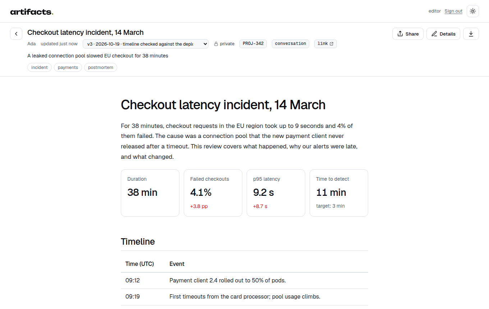
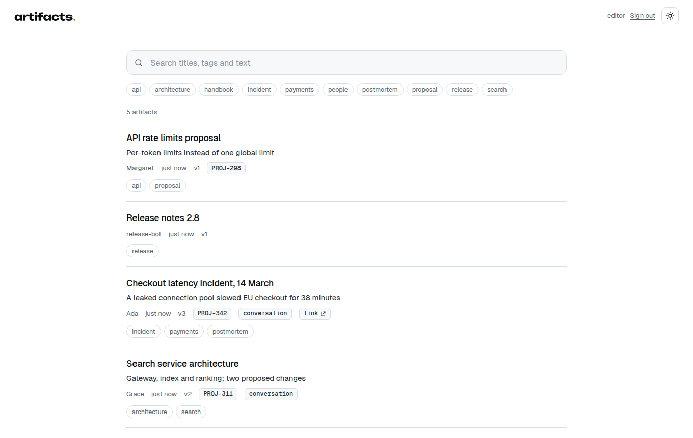
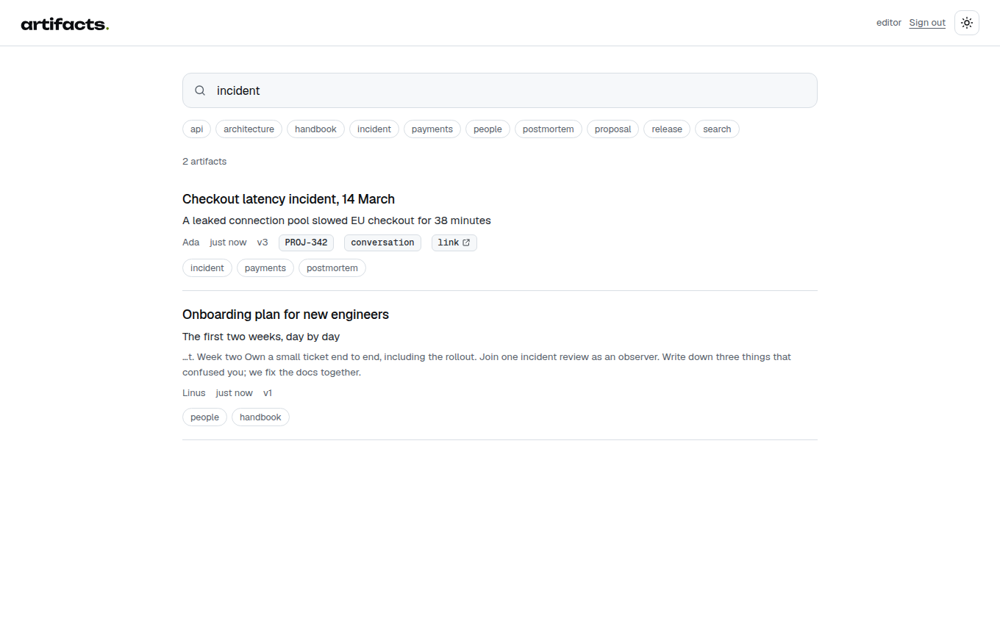

<p align="center">
  <picture>
    <source media="(prefers-color-scheme: dark)" srcset="assets/brand/wordmark-dark.svg">
    
  </picture>
</p>

<p align="center">
  <strong>Versioned documents that people and coding agents publish, find and share.</strong><br>
  Reports, plans, reviews and specs as HTML or Markdown pages, each with one stable address,<br>
  a version history, search, a reader with light and dark themes, and revocable share links. Stored in S3.
</p>

<p align="center">
  <a href="https://github.com/ly-solutions/artifacts/actions/workflows/ci.yml"></a>
  <a href="https://github.com/ly-solutions/artifacts/releases"></a>
  <a href="LICENSE"></a>
</p>

<p align="center">
  <a href="#quick-start">Quick start</a> ·
  <a href="#ways-to-run-it">Run it</a> ·
  <a href="docs/configuration.md">Configuration</a> ·
  <a href="docs/api.md">API</a> ·
  <a href="#architecture">Architecture</a> ·
  <a href="skills/README.md">Agent skill</a>
</p>

<p align="center">
  <picture>
    <source media="(prefers-color-scheme: dark)" srcset="docs/screenshots/reader-dark.png">
    
  </picture>
</p>

## Why artifacts

Coding agents write a lot of documents: incident reviews, migration plans, audits, research notes. Left alone they
end up as files in random repositories, pastes in chat, or five copies called "final", "v2" and "updated".
artifacts gives them one place:

- **One address per document, with history.** Publishing again under the same slug adds a version; the link people
  already have keeps working and shows the newest one, with every earlier version a click away.
- **No accidental copies.** Publishing a new document whose title matches an existing one (ignoring "v2", "final",
  "draft"…) is refused with the candidates listed, so agents update instead of duplicating.
- **Made for agents.** A small CLI and a ready-made [skill](skills/artifacts/SKILL.md) teach agents to search before
  writing, update the same slug, and share only when asked. Every API error says what to change.
- **Readable by default.** Markdown and HTML fragments get careful typography in light and dark; full HTML pages
  with charts and scripts are shown as written, inside a sandbox that keeps them away from cookies and the API.
- **Share outside, revoke anytime.** Signed read-only links with optional expiry; turning sharing off kills every
  link issued before.
- **Your storage.** Any S3-compatible bucket (AWS, MinIO, R2, Ceph, Garage…) or a directory. No database. Pods are
  stateless and can scale out.
- **Fits your stack.** Static tokens, any OpenID Connect provider, or an authenticating proxy. Task links, conversation
  links, webhooks and embedding are configuration, not code.

<table>
  <tr>
    <td width="50%">
      <picture>
        <source media="(prefers-color-scheme: dark)" srcset="docs/screenshots/catalog-dark.png">
        
      </picture>
    </td>
    <td width="50%">
      <picture>
        <source media="(prefers-color-scheme: dark)" srcset="docs/screenshots/search-dark.png">
        
      </picture>
    </td>
  </tr>
</table>

## Quick start

With Docker Compose (the server plus MinIO as the S3 store):

```bash
git clone https://github.com/ly-solutions/artifacts.git && cd artifacts
docker compose up --build
```

Open <http://localhost:8080/login> and paste the token `local-demo-token-change-me`. Then publish from a terminal:

```bash
export ARTIFACTS_URL=http://localhost:8080 ARTIFACTS_TOKEN=local-demo-token-change-me
printf '# Hello\n\nFirst version.\n' > hello.md

npx @ly-solutions/artifacts publish --file hello.md --tags demo   # prints http://localhost:8080/a/hello-x1y2z3
printf '# Hello\n\nSecond version.\n' > hello.md
npx @ly-solutions/artifacts publish --slug hello-x1y2z3 --file hello.md --note "second pass"
npx @ly-solutions/artifacts versions hello-x1y2z3
npx @ly-solutions/artifacts share hello-x1y2z3 --expires 7d       # a read-only link for someone outside
```

`node scripts/demo-seed.mjs` fills the catalog with the example documents from the screenshots.

Without Docker, a throwaway catalog in `./data`:

```bash
ARTIFACTS_AUTH=none npx @ly-solutions/artifacts serve
```

## The CLI

One command for people, agents and operators. It reads `ARTIFACTS_URL` and `ARTIFACTS_TOKEN`.

| Command | Does |
|---|---|
| `artifacts find [words…] [--tag t] [--task ID] [--session ID] [--all]` | search titles, tags and text; `--all` follows every page |
| `artifacts publish --file doc.md\|page.html [--title …] [--tags a,b] [--task ID] [--link URL]` | publish a new document |
| `artifacts publish --slug SLUG --file … --note "what changed"` | publish a new version of an existing one |
| `artifacts versions SLUG` | version history: number, date, author, note |
| `artifacts diff SLUG [FROM] [TO]` | what changed between two versions (default: the last two), as a unified diff |
| `artifacts get SLUG [--v N] [--format html\|markdown]` | read a version |
| `artifacts meta SLUG [--title …] [--add-tag t] [--task ID \| --no-task] [--link …]` | change metadata, no new version |
| `artifacts share SLUG [--expires 7d] [--rotate]` / `artifacts unshare SLUG` | open or revoke read-only links |
| `artifacts delete SLUG --yes` | delete with all versions |
| `artifacts serve` | run the server |
| `artifacts migrate --from-git REPO --to s3://bucket/prefix` | import a git repository with its history |

Local images in a page (``, ``) are embedded on publish, so documents are
self-contained. `ARTIFACTS_SESSION`, when set by an agent workspace, links every publish to its conversation.

## Ways to run it

| | Command | Details |
|---|---|---|
| **Node.js** | `npx @ly-solutions/artifacts serve` | Node 22+; fs or S3 |
| **Docker** | `docker run -p 8080:8080 -e ARTIFACTS_TOKEN=… -v data:/data ghcr.io/ly-solutions/artifacts` | non-root image with a health check |
| **Docker Compose** | `docker compose up` | server + MinIO, bucket created on start |
| **Kubernetes** | `helm install artifacts ./deploy/helm/artifacts --set storage.s3.bucket=…` | [chart README](deploy/helm/artifacts/README.md): ingress, probes, PDB, restricted security context, existing secrets |
| **Argo CD** | [`deploy/argocd/application.yaml`](deploy/argocd/application.yaml) | GitOps example |

[docs/deployment.md](docs/deployment.md) covers each option, systemd, proxies and CDNs.

## Configuration

Everything is an environment variable; the server refuses to start with an unsafe or broken configuration and
names the variable to fix. The essentials:

| Variable | Default | |
|---|---|---|
| `ARTIFACTS_PUBLIC_URL` | `http://localhost:8080` | the address people use |
| `ARTIFACTS_STORAGE` | `s3` if a bucket is set, else `fs` | storage driver |
| `ARTIFACTS_S3_BUCKET`, `ARTIFACTS_S3_ENDPOINT`, `ARTIFACTS_S3_REGION`, `ARTIFACTS_S3_PREFIX` | | S3 location (`AWS_*` credentials work) |
| `ARTIFACTS_DATA_DIR` | `./data` | fs driver directory |
| `ARTIFACTS_AUTH` | `token` | `token`, `oidc`, `proxy` or `none` |
| `ARTIFACTS_TOKEN` / `ARTIFACTS_READ_TOKEN` | | editor and viewer bearer tokens |
| `ARTIFACTS_OIDC_ISSUER`, `ARTIFACTS_OIDC_CLIENT_ID`, `ARTIFACTS_OIDC_CLIENT_SECRET` | | sign-in with any OIDC provider |
| `ARTIFACTS_TASK_URL` | | link template for tasks, e.g. `https://tracker.example.com/issue/{task}` |
| `ARTIFACTS_SESSION_URL` | | link template for the conversation a document came from |
| `ARTIFACTS_FRAME_ANCESTORS` | | origins allowed to embed the reader |
| `ARTIFACTS_WEBHOOK_URL` | | notified on every change, HMAC-signed |

The full reference, including every OIDC, proxy, content-policy and limit option: [docs/configuration.md](docs/configuration.md).

## API

A JSON API under `/api/v1` with bearer tokens — publish, versions, content, metadata, share, search, tags — plus
webhooks. Reference with examples: [docs/api.md](docs/api.md).

```bash
curl -s -H "Authorization: Bearer $ARTIFACTS_TOKEN" -H 'Content-Type: application/json' \
  -d '{"title":"Hello","markdown":"# Hello\n\nFrom curl."}' "$ARTIFACTS_URL/api/v1/artifacts"
```

## Architecture

```
 browser ── session (token / OIDC / proxy) ──┐        ┌── agents: CLI, skill, HTTP (Bearer)
                                             ▼        ▼
          ┌─────────────────────────────────────────────────────────────┐
          │ artifacts (Node.js, stateless)                              │
          │  catalog · reader · embed · shared view · /api/v1           │
          │  service: CAS on manifests, duplicate check, share tokens   │
          │  in-memory search index, refreshed by ETag                  │
          │  storage driver: s3 (SigV4, conditional PUT) | fs           │
          └──────────────────────────────┬──────────────────────────────┘
                                         ▼
     bucket:  meta/<slug>.json   content/<slug>/<version>/index.html|document.md
```

- Each version is an immutable object; a small manifest per document lists the versions and is updated with an
  ETag compare-and-swap, so concurrent publishers never lose a version.
- Published HTML is served from its own path under a CSP sandbox without `allow-same-origin`.
- Search keeps metadata and text in memory and re-reads only manifests whose ETag changed.

Details: [docs/architecture.md](docs/architecture.md) · storage layout, consistency and the git import:
[docs/storage.md](docs/storage.md).

## Agents and integrations

- **Agent skill.** [`skills/artifacts`](skills/README.md) is a Claude Code skill (and a plugin marketplace entry in
  this repository) that makes agents find before writing, update the same slug instead of creating "v2" copies, read
  versions and share only on request.
- **harnessly.** The workspace for people and coding agents embeds the reader in a pane, links documents to
  conversations and publishes from agent tabs. Contract: [docs/integrations/harnessly.md](docs/integrations/harnessly.md).
- **boards.** [ly-solutions/boards](https://github.com/ly-solutions/boards), whiteboards that agents read and draw,
  uses the same storage design and variable names, so both can share a bucket.

## Migrating from a git repository

If your documents live in a repository as one folder per document (`<slug>/index.html`, `meta.yaml`), import them
with their whole history; commit shas become version ids, so old `?v=<sha>` links resolve:

```bash
artifacts migrate --from-git https://git.example.com/team/docs.git --to s3://my-artifacts/ --dry-run
```

See [docs/storage.md](docs/storage.md#migrating-from-a-git-repository).

## Development

```bash
npm ci
npm test            # unit and HTTP tests; S3 against an in-process fake that verifies SigV4
npm run lint
npm run dev         # fs storage in ./data, no auth, restarts on change
```

Set `ARTIFACTS_TEST_S3_ENDPOINT` (plus `_BUCKET`, `_ACCESS_KEY_ID`, `_SECRET_ACCESS_KEY`) to run the storage and
service suites against a real S3 endpoint; CI does this against MinIO. See [CONTRIBUTING.md](CONTRIBUTING.md).

## Security

Report vulnerabilities privately through GitHub (Security → Report a vulnerability); see [SECURITY.md](SECURITY.md).

## License

[Apache-2.0](LICENSE). The bundled Geist fonts are under the [SIL Open Font License](web/fonts/OFL.txt). The compose
file uses a community build of MinIO, which is AGPL-3.0 and runs as a separate container.
